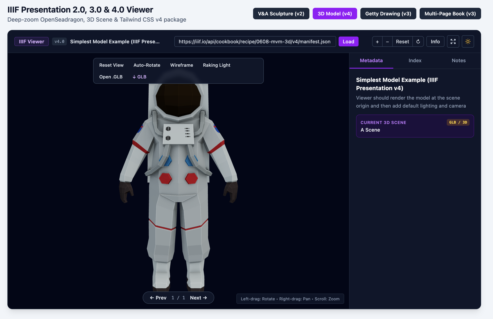

# IIIF Viewer (`@micropasts/iiif-viewer`)

A framework-agnostic **IIIF Presentation API 2.x, 3.0 & 4.0** viewer built with **OpenSeadragon**, **Three.js**, and **Tailwind CSS v4**. Designed for museums, archives, libraries, and digital heritage platforms to display deep-zoom 2D canvases, interactive 3D `.glb`/`.gltf` scenes, structural tables of contents, sanitized HTML metadata, and embedded annotations.

* **Live Demo:** https://micropasts.github.io/iiif-viewer/
* **Repository:** https://github.com/micropasts/iiif-viewer
* **Author:** Daniel Pett ([MicroPasts](https://github.com/micropasts))

### Screenshot of interface



## Features

* **IIIF Presentation 2.x, 3.0 & 4.0 Support:** Detects and normalizes common Presentation 2.x (`sequences`/`canvases`), Presentation 3.0 (`items`/`AnnotationPage`), and Presentation 4.0 (`Scene`/`Model`/`SpecificResource`) structures.
* **Deep-Zoom 2D & Interactive 3D in One Filmstrip:** Seamlessly switches between OpenSeadragon tiled/static 2D images and a built-in Three.js WebGL 3D scene viewer (`GLTFLoader` + `DRACOLoader`) with camera reset, auto-rotate, wireframe, raking light, local `.glb` file picker, and IIIF `RotateTransform` / `ScaleTransform` / `TranslateTransform` support.
* **Configurable Proxy Routing:** Rewrite manifest, `info.json`, static image, model, and thumbnail URLs through custom prefixes, regex rules, functions, or proxy endpoints via `proxyRoutes`, `proxyUrl`, and `assetProxyUrl`.
* **Safe HTML Metadata Rendering:** Sanitizes HTML inside manifest metadata values, summaries, attributions, and annotations—preserving formatting and safe links while stripping unsafe scripts or attributes.
* **Fullscreen & Scoped Dark/Light Themes:** Built-in Fullscreen API support (with a fixed-viewport fallback for sandboxed iframes) and isolated `.dark` class theming.

### Current limitations

* Annotation text is read from annotation pages embedded in the manifest and shown in the Notes panel. External annotation pages are not fetched, and annotations are not drawn as image overlays.
* The Index panel links top-level ranges whose first target is a canvas or scene; it does not traverse nested ranges.
* Metadata language maps prefer English, then `none`, then the first available language. Presentation 2 language-tagged arrays prefer English and otherwise combine available values. There is no language selection option.
* The local 3D file picker works best with self-contained `.glb` files; a `.gltf` file that refers to separate buffers or textures also needs those resources to be accessible.
* Draco-compressed models use decoders hosted by Google by default. Set `dracoDecoderPath` to a directory you host if external decoder requests are undesirable.

---

## Installation

### From npm

```bash
npm install @micropasts/iiif-viewer
```

### From GitHub Packages

Add a `.npmrc` file in your project root:

```ini
@micropasts:registry=https://npm.pkg.github.com
```

Then install:

```bash
npm install @micropasts/iiif-viewer
```

---

## Quick Start

### Vanilla JS / ES Modules

```javascript
import { IIIFViewer } from '@micropasts/iiif-viewer';
import '@micropasts/iiif-viewer/style.css';

const viewer = new IIIFViewer('#iiif-viewer', {
  manifestUrl: 'https://iiif.vam.ac.uk/collections/O24955/manifest.json',
  theme: 'dark',
  height: '680px',
});
```

Ensure your HTML contains the target mount element:

```html
<div id="iiif-viewer"></div>
```

### Using Custom Proxy Routes (Local Dev / CORS)

When a manifest contains embedded asset URLs pointing to a local dev server (such as `http://localhost:8000/images/...`) or an origin lacking `Access-Control-Allow-Origin` headers, configure `proxyRoutes`, `proxyUrl`, or `assetProxyUrl`:

```javascript
const viewer = new IIIFViewer('#iiif-viewer', {
  manifestUrl: 'http://localhost:8000/finds/1704/iiif/manifest',
  // Prefix map rewriting both manifest and embedded .glb / image URLs
  proxyRoutes: {
    'http://localhost:8000/images': '/images',
    'http://localhost:8000/finds': '/finds',
  },
});
```

You can also pass an array of `{ match, replace, types }` rules or a resolver function:

```javascript
const viewer = new IIIFViewer('#iiif-viewer', {
  manifestUrl: 'https://example.org/iiif/manifest.json',
  proxyRoutes: (url, resourceType) => {
    if (resourceType === 'model' && url.startsWith('http://localhost:8000/')) {
      return `/api/proxy-glb?url=${encodeURIComponent(url)}`;
    }
    return url;
  },
});
```

The first matching array or prefix-map rule wins. A resolver can return a falsy value to fall back to `proxyUrl` or `assetProxyUrl`. These options only rewrite URLs; the destination must actually serve or proxy the resource with appropriate CORS headers. `proxyUrl` and `assetProxyUrl` append the URL encoded with `encodeURIComponent`.

The viewer rewrites the manifest URL, image service `info.json` or static image URL, model URL, and thumbnail URL. It does not rewrite subsequent image tile requests or external resources referenced by a `.gltf` file; configure the image service or proxy and model hosting accordingly. `fetchOptions` applies only to the manifest fetch, not image or model requests.

### Passing an Inline Manifest Object

```javascript
const viewer = new IIIFViewer('#iiif-viewer', {
  manifest: myManifestJsonObject,
  theme: 'light',
  showUrlInput: false,
});
```

If both `manifest` and `manifestUrl` are supplied, the inline manifest takes precedence.

---

## Framework Integration Examples

### UMD Script Tag

```html
<link rel="stylesheet" href="./node_modules/@micropasts/iiif-viewer/dist/iiif-viewer.css" />
<div id="iiif-viewer"></div>

<script src="./node_modules/@micropasts/iiif-viewer/dist/iiif-viewer.umd.cjs"></script>
<script>
  const viewer = new IIIFViewer.IIIFViewer('#iiif-viewer', {
    manifestUrl: 'https://iiif.io/api/cookbook/recipe/0608-mvm-3d/v4/manifest.json',
  });
</script>
```

Serve the UMD file and stylesheet over HTTP with a JavaScript-compatible MIME type for the `.cjs` file; opening the HTML directly via `file://` can prevent manifests and assets from loading.

### React

```jsx
import { useEffect, useRef } from 'react';
import { IIIFViewer } from '@micropasts/iiif-viewer';
import '@micropasts/iiif-viewer/style.css';

export function MuseumIIIFViewer({ manifestUrl, theme = 'dark', proxyRoutes = null }) {
  const containerRef = useRef(null);
  const instanceRef = useRef(null);

  useEffect(() => {
    if (!containerRef.current) return;
    instanceRef.current = new IIIFViewer(containerRef.current);

    return () => {
      instanceRef.current?.destroy();
      instanceRef.current = null;
    };
  }, []);

  useEffect(() => {
    instanceRef.current?.setTheme(theme);
  }, [theme]);

  useEffect(() => {
    instanceRef.current?.setProxyRoutes(proxyRoutes);
  }, [proxyRoutes]);

  useEffect(() => {
    if (manifestUrl) instanceRef.current?.loadManifest(manifestUrl);
  }, [manifestUrl]);

  return <div ref={containerRef} />;
}
```

### Vue 3

```vue
<script setup>
import { onMounted, onBeforeUnmount, ref, watch } from 'vue';
import { IIIFViewer } from '@micropasts/iiif-viewer';
import '@micropasts/iiif-viewer/style.css';

const props = defineProps({
  manifestUrl: { type: String, required: true },
  theme: { type: String, default: 'dark' },
  proxyRoutes: { type: [Object, Array, Function], default: null },
});

const container = ref(null);
let viewer = null;

onMounted(() => {
  viewer = new IIIFViewer(container.value, {
    manifestUrl: props.manifestUrl,
    theme: props.theme,
    proxyRoutes: props.proxyRoutes,
  });
});

watch(() => props.manifestUrl, (url) => url && viewer?.loadManifest(url));
watch(() => props.theme, (theme) => viewer?.setTheme(theme));
watch(() => props.proxyRoutes, (routes) => viewer?.setProxyRoutes(routes));

onBeforeUnmount(() => viewer?.destroy());
</script>

<template>
  <div ref="container" />
</template>
```

---

## Configuration Options

| Option | Type | Default | Description |
| :--- | :--- | :--- | :--- |
| `manifestUrl` (or `url`) | `string` | `''` | URL of a IIIF Presentation 2.0, 3.0, or 4.0 manifest to fetch on mount. |
| `manifest` (or `data`) | `object \| string` | `null` | Pre-loaded IIIF manifest JSON object or JSON string. |
| `proxyRoutes` | `object \| array \| function` | `null` | Rewrites manifest and asset URLs (`'manifest'`, `'image'`, `'model'`, `'thumbnail'`). Accepts `{ prefix: replacement }`, `[{ match, replace, types }]` with string or `RegExp` matches, or `(url, resourceType) => string`. Array rule `types` is optional. |
| `proxyUrl` | `string` | `''` | Prefix URL prepended to `encodeURIComponent(url)` when fetching manifests. |
| `assetProxyUrl` | `string` | `''` | Prefix URL prepended to `encodeURIComponent(url)` when fetching downstream images, `.glb` models, and thumbnails. |
| `dracoDecoderPath` | `string` | Google CDN 1.5.7 | Path/URL to Draco WASM/JS decoders for Draco-compressed `.glb` models. |
| `theme` | `'dark' \| 'light'` | `'dark'` | Initial scoped theme for the viewer container. |
| `height` | `string` | `'680px'` | CSS height of the viewer container when not in fullscreen; the viewer has a 540px minimum height. |
| `showUrlInput` | `boolean` | `true` | Shows or hides the manifest URL input bar in the top toolbar. |
| `showSidebar` | `boolean` | `true` at widths ≥ 768px; otherwise `false` | Initial visibility of the Metadata / Index / Notes sidebar. |
| `initialCanvas` | `number` | `0` | Zero-based index of the initial canvas or 3D scene to display. |
| `fetchOptions` | `RequestInit` | `{}` | Optional manifest `fetch` options (such as `credentials` or custom `headers`). |
| `onSelectScene` | `function` | `null` | Optional callback `(container, sceneData, meta) => instance` for custom 3D scene rendering. |

`onSelectScene` receives the container element, normalized scene data (`modelUrl`, `format`, `transforms`, and `thumbnail`), and `{ theme, title }`. The `modelUrl` is already resolved through proxy routing. The returned instance may implement `destroy()`, `setTheme(theme)`, and `handleResize()`; the viewer calls these when available.

---

## Instance Methods

| Method | Signature | Description |
| :--- | :--- | :--- |
| `loadManifest` | `async loadManifest(url)` | Fetches and renders a IIIF manifest from the given URL (applying `proxyRoutes` / `proxyUrl`). |
| `setManifest` | `setManifest(jsonOrString)` | Parses and renders a manifest JSON object or string directly. |
| `goToCanvas` | `goToCanvas(index)` | Navigates to the specified zero-based canvas or 3D scene index. |
| `setProxyRoutes` | `setProxyRoutes(routes)` | Updates `proxyRoutes` at runtime and reloads the active canvas/scene. |
| `resolveUrl` | `resolveUrl(url, resourceType)` | Resolves a URL through configured `proxyRoutes`, `assetProxyUrl`, or `proxyUrl`. |
| `setTheme` | `setTheme('dark' \| 'light')` | Switches the viewer theme between dark and light mode. |
| `toggleTheme` | `toggleTheme()` | Toggles between dark and light mode. |
| `toggleSidebar` | `toggleSidebar()` | Shows or hides the right-hand Metadata / Index / Notes sidebar. |
| `enterFullscreen` | `async enterFullscreen()` | Expands the viewer to fullscreen (with fixed-viewport fallback). |
| `exitFullscreen` | `async exitFullscreen()` | Exits fullscreen mode. |
| `toggleFullscreen` | `toggleFullscreen()` | Toggles fullscreen mode. |
| `destroy` | `destroy()` | Cleans up OpenSeadragon, Three.js WebGL contexts, event listeners, and DOM nodes. |

`loadManifest` and `setManifest` display fetch or parsing errors in the viewer instead of propagating them to the caller.

---

## Local Development & GitHub Pages Build

Use Node.js 20 or 22 and npm for local development (the current project uses Vite 6). Vite 8 requires Node.js 20.19+ or 22.12+ and a change to the docs build's `manualChunks` configuration; it is not currently configured for this project.

```bash
# Install dependencies
npm install

# Start local dev server (includes /images and /finds proxy to http://localhost:8000)
npm run dev

# Build npm library bundle into dist/
npm run build

# Build static demo site into docs/ for GitHub Pages
npm run build:docs
```

## License

This project is licensed under the **Mozilla Public License Version 2.0 (MPL-2.0)** — see the [LICENSE.md](./LICENSE.md) file for details.